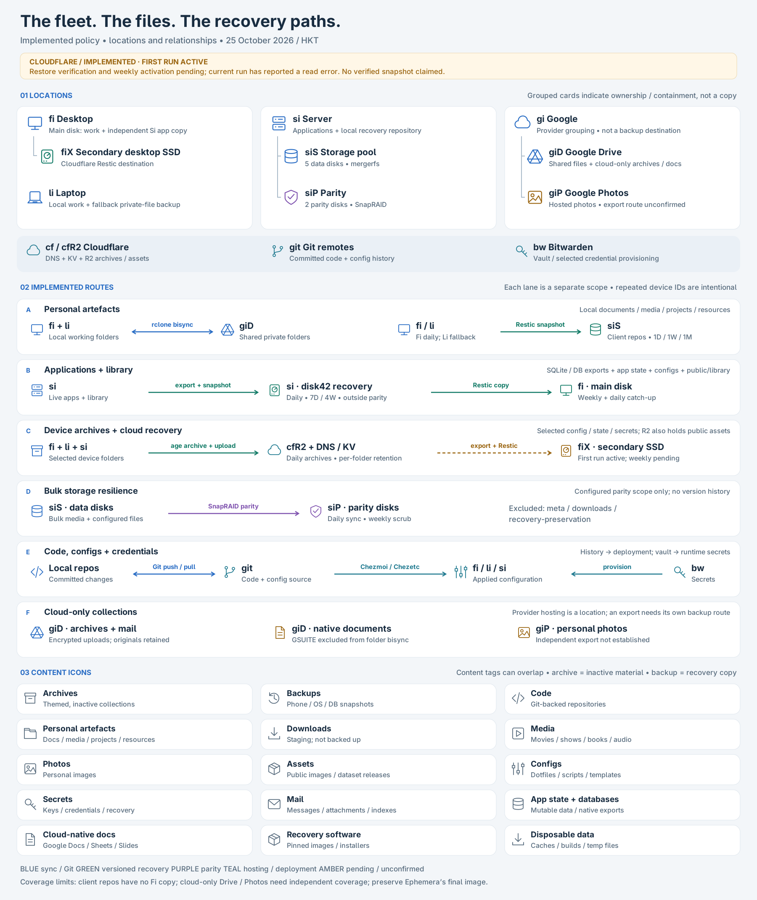

# Dotjik

Home and system configuration applied by Tjikup. The GitHub repository remains
`tijptjik/dotfiles`, checked out at `~/.local/share/dotjik`. System policy from
Systjik now lives in `system/` within this repository.

Tjikup owns deployment and maintenance for every fleet host. Home configuration
lives in `native/home/files/`; system policy lives in `system/native/`. MiniJinja
`.j2` templates render natively. `dotjik` and `systjik` delegate to the native
configuration commands. Synctjik owns backup and recovery operations.

See [workflows and native file ownership](docs/tjikup.md) and
[new devices](docs/new-devices.md). Release publication and pin updates are
currently deferred; the source migration does not update published bootstrap.

## Supported Devices

- `fi` - Desktop (client)
- `li` - Laptop (client)
- `si` - Server

## Supported Software

Readmes are available in `/docs/{topic}.md`

- [`bat`](https://github.com/sharkdp/bat)
- [`bottom`](https://github.com/ClementTsang/bottom)
- [`codex`](https://openai.com/codex/)
- [`direnv`](https://direnv.net/)
- [`fish`](https://fishshell.com/)
  - [`fisher`](https://github.com/jorgebucaran/fisher) - Plugin manager with automatic updates
- [`fzf`](https://github.com/junegunn/fzf)
- [`glow`](https://github.com/charmbracelet/glow)
- [GTK](https://www.gtk.org/)
- [`herdr`](https://github.com/ogulcancelik/herdr)
- [Hyprland](https://github.com/hyprwm/Hyprland)
  - [`hyprfloat`](https://github.com/nevimmu/hyprfloat)
  - [`hypridle`](https://github.com/hyprwm/hypridle)
  - [`hyprlock`](https://github.com/hyprwm/hyprlock)
  - [`hyprpaper`](https://github.com/hyprwm/hyprpaper)
  - [`hyprpicker`](https://github.com/hyprwm/hyprpicker)
  - [`hyprsunset`](https://github.com/hyprwm/hyprsunset)
  - [`hyprvoice`](https://github.com/leonardotrapani/hyprvoice)
- [`kitty`](https://sw.kovidgoyal.net/kitty/)
- [`lazygit`](https://github.com/jesseduffield/lazygit)
- [`llmtrim`](https://github.com/fkiene/llmtrim)
  - [`llmtrim-herdr`](https://github.com/fkiene/llmtrim-herdr)
- [`lsd`](https://github.com/lsd-rs/lsd)
- [`matugen`](https://github.com/InioX/matugen)
- [`micro`](https://micro-editor.github.io/)
- [`mullvad`](https://mullvad.net/)
- [`notjik`](https://github.com/tijptjik/tjikos/tree/main/apps/notjik) — [desktop notification setup](docs/notjik.md)
- [`python`](https://www.python.org/)
- [`quickshell`](https://github.com/quickshell-mirror/quickshell)
- [`rclone`](https://github.com/rclone/rclone)
- [`solaar`](https://github.com/pwr-Solaar/Solaar)
- [`starship`](https://github.com/starship/starship)
- [systemd](https://systemd.io/)
- [`Tailscale`](https://tailscale.com/) — [Li and Si setup with timed
  rollback](docs/tailscale-setup.md)
- [`tinty`](https://github.com/tinted-theming/tinty)
- [`transmission`](https://github.com/transmission/transmission)
- [`uv`](https://github.com/astral-sh/uv)
- [`vivid`](https://github.com/sharkdp/vivid)
- [`bartjik`](https://github.com/tijptjik/tjikos/tree/main/apps/bartjik)
- [`zapzap`](https://github.com/rafatosta/zapzap)
- [`zed`](https://zed.dev/)

## Backups and recovery

The **[fleet storage atlas](docs/fleet-backup-atlas.md)** explains where files
live across Fi, Li, Si, Google and Cloudflare, with device and content icons,
backup locations, schedules, and retention.

[](docs/fleet-backup-atlas.md)

- **[Read the atlas and diagram explanation](docs/fleet-backup-atlas.md)** —
  locations, content types, sync, snapshots, archives, parity and configuration.
- **[Backup map](docs/fleet-backup-map.md)** — current scopes, schedules,
  retention and coverage boundaries.
- [Device archives and cross-device restore](docs/device-archives.md) ·
  [Private-file sync and backups](docs/private-storage.md) ·
  [Server application backups](docs/si-application-backups.md) ·
  [Cloudflare backups](docs/cloudflare-backups.md)

The diagrams describe configured backup routes and schedules. The linked setup
guides describe their scope and recovery procedures.

### Server media

- [Extracting archived Sonarr releases](docs/media-archive-extraction.md)

## Sample Run


## Installation on New Machine

The new cold-bootstrap path is documented in [the device guide](docs/new-devices.md).
It installs early Fedora dependencies, clones public sources over HTTPS, enrolls
this hostname with `tjikup new device`, and unlocks the existing Bitwarden/age
credentials before any file apply. Download and review `https://sh.type.hk/init`;
the script embeds exact published source revisions. See the guide for release
verification and first-apply instructions.

Existing Fi/Li/Si profiles remain separate from new desktop/laptop/server roles.
New machines do not inherit their disk mounts or backup policies. Recipe
subscriptions are local, explicit, and include required dependencies. Review
`tjikup --plan` before the first apply.

### Tailscale and Collie on a new device

Tjikup's Tailscale recipe installs Tailscale, enables `tailscaled`, configures the local
user as its operator, and keeps the daemon outside Mullvad on client hosts.
Tailscale membership is deliberately not versioned: join each Linux device
interactively after running that recipe.

```bash
tailscale up
```

Install the Tailscale Android app and sign in to the same tailnet. On `fi`, a
subsequent `tjikup` installs/configures Collie for the local Herdr
session and reserves the tailnet-only Vite route on HTTPS port 8443. Collie is
reachable only while `fi` is locked; its Hyprlock wrapper brings the node up
after locking and takes it down again on unlock.

## Usage

Before making any changes, it is recommended to pull the latest version of the dotfiles to avoid conflicts.

### Updating

#### `tjikup`

`tjikup` is a configurable runner maintained in [tjikOS](https://github.com/tijptjik/tjikos/tree/main/apps/tjikup). This repository supplies [the fleet workflow](tjikup.json): capture supported live settings, commit those templates, pull/push Dotjik and tjikOS, then apply home and system configuration through the recipe graph. See [ownership, migration and validation](docs/tjikup.md).

Status rows use the terminal width, align notes on the right, and shorten long text with an ellipsis. Full messages remain in the run report. Child apply commands inherit the terminal width; redirected output defaults to 80 columns.

Run it after changing supported live configuration files:

```bash
tjikup
```

Use `tjikup --dry-run` to print the recipe plan without executing commands.

Zed propagation updates existing scalar settings and preserves template settings absent from the live config, including settings not yet applied to this host. To remove a managed setting, edit its native `.j2` template.

On clients, the Tjikup recipe installs or updates `codex-lb` in `~/.codex-lb/runtime`. After an update, run `systemctl --user restart codex-lb.service` between Codex sessions to activate it; the update script leaves the running proxy alone to avoid interrupting requests.

Use `tjikup --skip-conflicts` to automatically skip conflicting files during the legacy home Tjikup apply, preserving their local contents while applying other changes. Native file conflicts always stop that file deployment. Other apply errors still fail the command.

Apply stages stream plain output to avoid terminal capability replies leaking from Gum spinners. Interactive prompts remain available.

### Editing

Use `dotjik edit TARGET` to open the native source, or `dotjik source-path TARGET`
to locate it. Edit plain files and `.j2` templates under `native/home/files/`;
file metadata and host selection live in `native/home/files.json`. New files need
an explicit manifest entry. Captured settings write back to these native sources.

See [home file commands and recovery](docs/tjikup.md#home-files-and-captured-settings).

## Validation

Run `bash scripts/validate.sh` to check Python and non-template shell syntax and
run the isolated Tjikup regression tests. Requires Python 3 with `cryptography`
and Fish; it does not apply dotfiles, access secrets, install packages, or
synchronize Git.
Native template rendering and host-specific behavior have separate fixture checks.

## Configuration recovery

Minimal encrypted Telegram, Brave, Steam and FirefoxPWA backups are enabled on
Fi and Li. Zen uses its own sync. uv has no separate configuration to archive;
`layout uv` selects the project's `.venv` and leaves dependency installation to
an explicit `uv sync`. Li's Tjikup fstab matches its current disks and mounts.

See the [configuration restoration guide](docs/config-restoration-plan.md) for
selected files, recovery limits and verification status.
