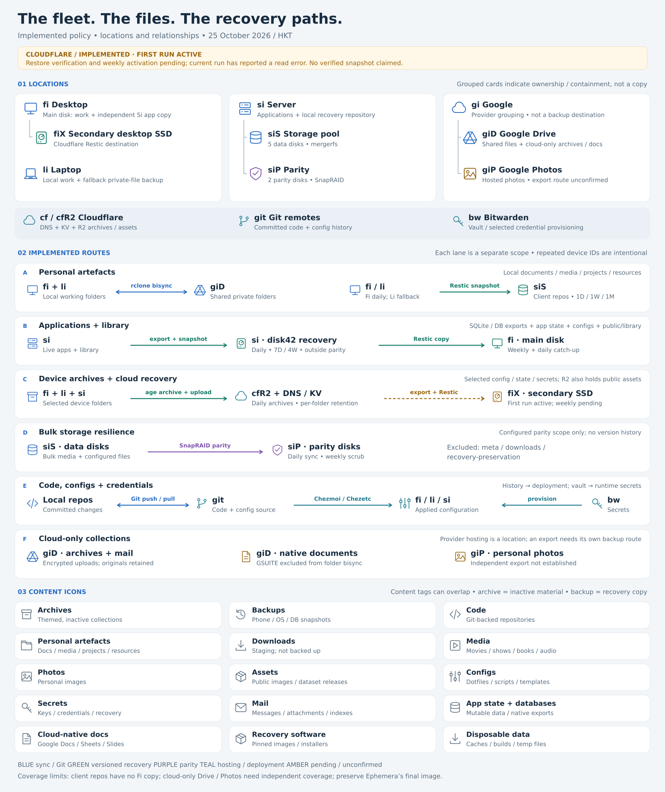

# Fleet storage atlas

[Full-resolution PNG](assets/fleet-backup-atlas.png) ·
[Editable SVG](assets/fleet-backup-atlas.svg) ·
[Policy and evidence](fleet-backup-map.md)

## Implementation status

The diagram describes implemented routes, with pending or unconfirmed coverage
explicitly marked. Cloudflare credentials, exports, mounted destination, backup
program and managed units are installed. Its first backup is **actively running**
as of 25 October 2026, approximately 12:07 HKT (60% by bytes at inspection).
One input/output read error has been reported; a clean snapshot is not yet
established. The automatic completion service requires a successful backup and
isolated restore before enabling the weekly timer. **Implemented and running does
not yet mean restore-verified or weekly-active.** See [activation details](cloudflare-backups.md).

Other route schedules come from the managed policy and the earlier dated evidence
in the policy map; they were not all rechecked to produce this drawing.

## Location icons

| ID | Location | Meaning in this setup |
| --- | --- | --- |
| `fi` | Desktop | Local working folders; independent Si application repository on the main/home filesystem |
| `fiX` | Secondary desktop SSD | Cloudflare Restic repository; distinct from Fi's server-application copy |
| `li` | Laptop | Local working folders; private-backup fallback when Fi has not succeeded that day |
| `si` | Server | Applications, storage and recovery jobs |
| `siS` | Server storage pool | Five mergerfs data disks; private client repositories and public collections |
| `siP` | Server parity | Two SnapRAID parity disks; configured scope only |
| `gi` | Google | Parent provider grouping, not shorthand for a second machine or Drive |
| `giD` | Google Drive | `type-drive:`; synchronized private files, cloud-only archives and Google-native documents |
| `giP` | Google Photos | Provider-hosted personal photos; upload/export automation not established by inspected configuration |
| `cf` / `cfR2` | Cloudflare / R2 | DNS/KV exports and object storage, including device archives and public assets |
| `git` | Git remotes | Committed code and configuration history |
| `bw` | Bitwarden | Hosted vault and selected Secrets Manager provisioning; independently recoverable vault access is required |

The server's application repository is at
`/mnt/data/disk42/.recovery-preservation/app-backups/repository`. It is a recovery
area on a data disk, excluded from parity; the diagram does not depict an extra
physical disk. The independent copy lives at
`fi:~/.local/share/si-app-backups/repository`, **not on `fiX`**.

## Content icons and coverage

Content tags are deliberately nonexclusive. **Archive** describes inactive,
themed material; **backup** describes a recovery copy. Mail, photos, secrets or
code can also be archived or backed up. A folder named `backups` does not establish
a recurring job or a successful restore.

| Type | Meaning / location | Protection boundary |
| --- | --- | --- |
| Archives | Themed inactive collections; e.g. `giD:private/archives/` | Drive-only archives are outside hourly private-folder sync and its Restic scope |
| Backups | Phone exports, OS/partition images, DB dumps, snapshots | The recurring Restic routes below are defined; no blanket phone/OS image job is implied |
| Code | Git-backed repos on workstations and remotes | Git protects pushed commits; `~/code`, uncommitted/untracked files and repository secrets are outside the four-folder private backup |
| Personal artefacts | Fi/Li `~/documents`, `~/media`, `~/projects`, `~/resources` | Hourly Drive bisync plus client Restic snapshots on Si; uppercase `~/Documents` is outside this job |
| Downloads | Pre-organized staging / downloads | Deliberately excluded from backup and Si parity |
| Media | Si movies, shows, books and audiobooks | Configured bulk parity; most public media excluded from application Restic. Only `public/library` has the documented library backup, not `public/books` or `library.bak` |
| Photos | Personal images in local folders and/or Google Photos | Local images inherit their folder's protection; Google Photos export/independent backup is unconfirmed |
| Assets | Public image and dataset releases, including R2 objects | R2 objects are in the implemented Cloudflare-to-fiX scope; first verified recovery is pending |
| Configs | Git-managed dotfiles, scripts, templates, Compose and system configuration | Git history + Chezmoi/Chezetc deployment; selected live state also in device/app backups |
| Secrets | Keys, credentials, encryption/recovery material | Bitwarden provisioning and selected age-encrypted device archives; never committed to Git |
| **Mail** | Messages, attachments, indexes and reader exports | Encrypted structured archives under `giD:private/archives/mail/structured/`; no independently scheduled Drive-archive backup established |
| **App state / databases** | Mutable application data, SQLite/Plex, MariaDB | Application-consistent exports → Si Restic → independently encrypted Fi repository |
| **Cloud-native documents** | Google Docs, Sheets and Slides in `GSUITE/` | Excluded from local folder sync; independent export/backup remains undefined |
| **Recovery software** | Pinned container images, installers, recovery tools | Ephemera's final image still needs explicit preservation; normal app-state backups exclude Docker layers |
| **Disposable data** | Caches, builds, temporary files, regenerable output | Explicit exclusions; keep separate from irreplaceable content |

The first three additions—mail, application state/databases, and cloud-native
documents—are necessary to explain current coverage. Recovery software explains
the Ephemera gap; disposable data explains intentional exclusions. Private WGS
data is also excluded from the app job and needs a separate policy if retained
as irreplaceable research data; do not assume public-asset coverage applies.

## Relationship types

| Relationship | Direction | What it guarantees / does not guarantee |
| --- | --- | --- |
| **rclone bisync** | Fi/Li ↔ giD | Shared working state; edits/deletions propagate. Recovery copies retained 31 days; separate Restic provides snapshots |
| **Restic snapshot** | Source → repository | Encrypted versioned recovery for selected scope; requires successful runs and available decryption keys |
| **Restic copy** | Repository → independent repository | Copies snapshots under destination encryption; Fi receives Si app snapshots, not private client repos |
| **Encrypted archive upload** | Selected source → R2 or Drive | age packaging, upload and readback verification; folder retention and destination depend on policy |
| **Application-consistent export** | Running service → backup input | SQLite online backup / MariaDB dump; API exports for DNS/KV. Cloudflare exports are not transactional across products |
| **Git push / pull** | Local repository ↔ Git remote | Committed history; no automatic protection for local-only work |
| **Config deployment** | Checked-out source → device | Chezmoi/Chezetc renders and applies desired state; deployment is not a backup |
| **Secret provisioning** | Bitwarden → selected runtime files | Supplies credentials with restricted permissions; not universal credential-file synchronization |
| **Hosted service** | Content held by provider | Google Photos, Drive, Bitwarden; hosting alone does not establish an independently recoverable copy |
| **SnapRAID parity** | Configured data → parity | Scheduled disk-failure/corruption protection, not independent version history; exclusions matter |
| **Containment / mount / access** | Device contains storage, or client accesses it | A location/access relationship with no implied data copy; neutral grouping in the diagram |
| **Restore / recovery** | Repository or archive → isolated target | The reverse operational path, verified separately; do not draw it as a continuously running synchronization job |

For each copy route record **scope, schedule, retention, encryption/key location,
failure domain and last verified recovery**. These attributes explain more than
adding more file categories.

## Implemented schedule summary

All times HKT; persistent timers may catch up and some runs include jitter.

- **Personal:** Fi Drive sync at :05 and Li at :35 hourly. Fi Restic at 00:00;
  Li 01:00 fallback; 1 daily / 1 weekly / 1 monthly. Li-only unsynchronized edits
  can remain unprotected when its fallback skips. No independent copy of these
  client repositories is configured in the Si-to-Fi app job.
- **Server apps:** Si 04:00, 7 daily / 4 weekly. Fi Restic copy Sunday 06:00,
  daily 10:00 freshness/catch-up. Fi is geographically offsite only when elsewhere.
- **Device archives:** Fi 00:00, Li 00:15, Si 00:30. Selected per-host folders;
  latest only, or latest + previous week + previous month according to policy.
- **Cloudflare:** first run active; target Sunday 03:00 and 1 weekly / 1 monthly
  after successful first backup and isolated restore. Scope is DNS/settings, KV
  and R2, not all Cloudflare products.
- **Parity:** daily 05:00 sync; Sunday 08:00 scrub of 25% of eligible blocks.
  Excludes `meta/`, downloads and `.recovery-preservation/`.

## Sources and editing

- [Policy/evidence map](fleet-backup-map.md)
- [Private storage](private-storage.md)
- [Device archive policy](device-archives.md)
- [Si app recovery](si-application-backups.md)
- [SnapRAID maintenance](si-snapraid-maintenance.md)
- [Cloudflare activation](cloudflare-backups.md)
- [Mail archive format](email-archive.md)

The SVG uses original line icons and editable text, with no remote assets.
Rebuild with `python3 scripts/render_fleet_backup_atlas.py`; add `--png` when
CairoSVG is available. Status wording is a dated documentation snapshot, not
an automatically refreshed monitoring dashboard.
