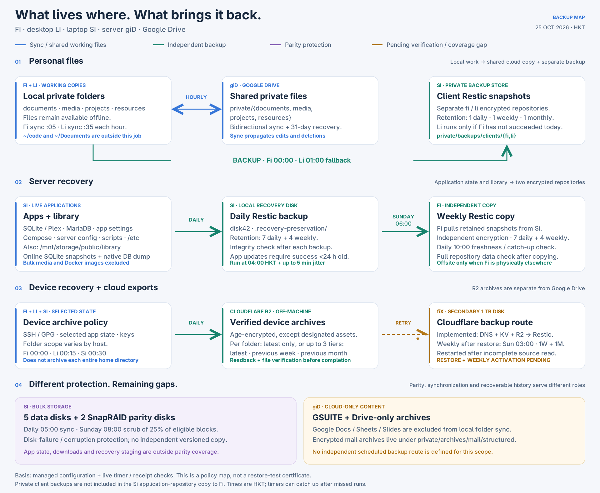

# Fleet storage and backup map

[PNG](assets/fleet-backup-map.png) · [Editable SVG](assets/fleet-backup-map.svg)

The [iconographic fleet atlas](fleet-backup-atlas.md) expands this policy map with
device, content and relationship icons. `gi` means Google; `giD` means Google
Drive (`type-drive:`), and `giP` means Google Photos. This map records configured
scope and dated receipt/timer evidence on 25 October 2026 HKT. It does not change
schedules, retention, sharing, or backup destinations.

## Coverage

| Content | Working location | Backup or protection | Retention / schedule |
| --- | --- | --- | --- |
| Lowercase documents, media, projects, resources | Local Fi/Li folders, hourly bisync through giD `private/` | Encrypted per-client Restic repositories on Si | Fi 00:00, Li 01:00 fallback; 1 daily / 1 weekly / 1 monthly |
| Selected device settings, SSH/GPG, keys and application state | Host-specific folders on Fi/Li/Si | Verified archives in Cloudflare R2; age encryption except explicit asset exceptions | Fi 00:00, Li 00:15, Si 00:30; latest only or latest + previous ISO week + previous month |
| Si applications, Plex, MariaDB, config, scripts and public/library | Si app state and library | Daily Restic on Si disk42, then independently encrypted Restic copy on Fi | Si 04:00; Fi Sunday 06:00 plus daily 10:00 check/catch-up; 7 daily + 4 weekly |
| Bulk data on Si | Five data disks | Two SnapRAID parity disks; separate from versioned backup | Daily 05:00 sync; Sunday 08:00 25% scrub of eligible blocks |
| Google-native documents, Drive-only archives and structured mail exports | giD GSUITE / private archives | No independent scheduled route defined by the inspected policy | Outside the four local-folder backups |
| Cloudflare DNS, KV and R2 | Cloudflare | Implemented export/Restic route to fiX, Fi's secondary 1 TB disk; first run active | Weekly Sunday 03:00, 1 weekly + 1 monthly pending successful backup and isolated restore |

Schedules are HKT and may include jitter. Persistent timers catch up when the
host/user manager is available. Private Li backup is suppressed when Fi has
already completed a verified backup that day. This fallback does not guarantee
Li-only unsynchronized edits have a snapshot on Si.

## Live evidence collected

| Check | Observation |
| --- | --- |
| Fi private backup | Success receipt: 25 Oct 00:09:40 HKT; matching server coordination receipt exists |
| Fi Drive sync | Success receipt: 24 Oct 23:07:38 HKT |
| Li Drive sync | Success receipt: 25 Oct 00:37:07 HKT |
| Li private backup | No local success receipt; timer active, next scheduled run 25 Oct 01:00 HKT |
| Si application backup | Success receipt: 24 Oct 04:12:46 HKT; daily timer active |
| Fi independent Si copy | Receipt copied at 22 Oct 01:09:11 HKT; source snapshot 21 Oct 22:18 HKT; data check passed |
| Si SnapRAID sync | Success receipt: 24 Oct 05:20:16 HKT |
| Si SnapRAID scrub | Success receipt: 21 Oct 20:08:35 HKT |
| Fi device archives | 30 local archive receipts; latest recorded snapshot 24 Oct 13:56:24 HKT; timer active |
| Fi Cloudflare backup | Updated 12:39 HKT: patched job restarted after an incomplete source read; partial snapshot retained. Complete backup/restore pending; weekly timer disabled |

These observations are point-in-time. The Cloudflare row was refreshed during
the already-running activation job; other rows retain their earlier evidence.
No additional backup, restore or parity job was started for this diagram update.

## Boundaries and recommended follow-up

1. Preserve Ephemera's final container image as a checksummed recovery artifact.
   Its running image reports version 2.0.0; application-state backups exclude
   Docker image layers. Skipping updates alone does not make a lost image
   recoverable when the registry can no longer supply it.
2. Define independent coverage for giD's Google-native documents and Drive-only
   archives, including the encrypted mail collection. Export formats and version
   retention need an explicit policy; ordinary Drive synchronization is not that
   backup.
3. Copy the private client Restic repositories to an independent destination if
   loss of Si must be recoverable. The existing Si-to-Fi application copy does
   not include these repositories. Review the short 1D/1W/1M retention against
   the desired recovery window.
4. Finish [Cloudflare activation](cloudflare-backups.md). The route is implemented,
   credentials and writable mount are installed, and the patched backup restarted
   after an incomplete source read. Inspect the final result before claiming
   coverage. The automatic handoff requires a successful snapshot and isolated
   restore before enabling the weekly timer. Neither completion nor verified
   recovery is claimed yet.
5. Schedule isolated restore rehearsals for a client folder, a Plex/SQLite
   snapshot, MariaDB and the library. The existing health checks establish
   repository/backup evidence, not full application recovery. Confirm recovery
   secrets are available independently of the machines being restored.

Fi's copy is geographically offsite only when Fi is elsewhere. SnapRAID excludes
`meta/` and `.recovery-preservation/`; it does not replace app backups. Downloads,
other public media, private WGS, Docker images, and several generated caches are
outside the application Restic job. Historical `document-archives` remain
recoverable on Si, but are no longer the daily private-file backup mechanism.

## Source references

- [Private storage](private-storage.md) and the managed `private-storage` tool.
- [Device archives](device-archives.md) and `home/dot_config/archive-policy.json`.
  The JSON policy is authoritative for current per-folder assignments.
- [Si application backups](si-application-backups.md) and the server backup script.
- [SnapRAID maintenance](si-snapraid-maintenance.md).
- [Email archive format](email-archive.md).
- `home/dot_local/bin/executable_cloudflare-restic-backup` and its user timer.
- Related Chezetc source: `etc/si-app-backup/`, `etc/si-provision/update_apps.py`,
  `etc/.chezmoiscripts/run_after_95-si-app-updates.fish.tmpl`.
